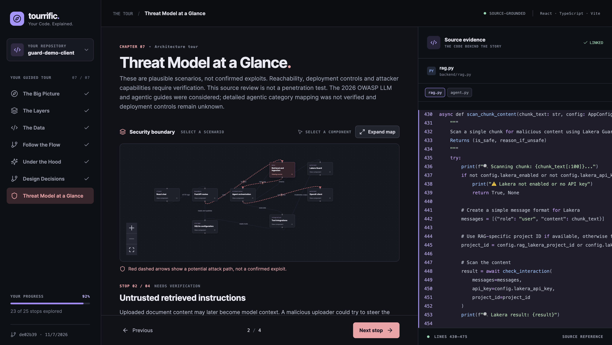

# Tourrific

Tourrific turns a codebase into an interactive, source-grounded architectural tour and lightweight threat model. An AI coding agent examines the repository and writes the narrative; Tourrific's scripts validate and package the evidence, and a local viewer presents it. The indexer does not execute the target project's code.



## Install

Tourrific is distributed from this GitHub repository. Review the source before installing, and use a tagged release or commit if you want to pin the version.

Clone the repository, then install the viewer's dependencies and build its assets:

```sh
git clone https://github.com/eurogig/tourrific.git
cd tourrific
npm ci --prefix tools/tourrific/viewer
npm --prefix tools/tourrific/viewer run build
```

Install the skill for Codex, Claude Code, or both:

```sh
python3 tools/tourrific/scripts/install-skill.py --agent codex --scope user
python3 tools/tourrific/scripts/install-skill.py --agent claude --scope user
# Or install for both agents:
python3 tools/tourrific/scripts/install-skill.py --agent both --scope user
```

The installer links the skill to this checkout, so keep the cloned repository in place. User scope installs for your account. To install into one project instead, run from that project and use `--scope project`; for example:

```sh
python3 /path/to/tourrific/tools/tourrific/scripts/install-skill.py --agent both --scope project
```

If an installation already exists, the installer leaves it alone. Use `--replace` to back up a conflicting installation and install this copy.

## Generate a tour

Open the repository you want to understand in Codex or Claude Code and invoke the `tourrific` skill. You can also ask the agent to use `--repo /path/to/repository` for another local repository, or `--output /path/to/output` for a custom output location.

The skill reuses a valid tour when its repository snapshot still matches. Ask it to regenerate or refresh the tour to force a fresh analysis. Generated tours go in `.tourrific/` by default. The agent starts a local preview server and returns its URL; it does not open a browser automatically.

## What's included

- `.agents/skills/tourrific/`: the canonical skill instructions, linked to the packaged resources below.
- `tools/tourrific/scripts/`: repository indexing, packaging, verification, and installation commands.
- `tools/tourrific/schema/`: the tour data schema.
- `tools/tourrific/viewer/`: the interactive tour viewer.
- `tools/tourrific/README.md`: the full workflow and command reference.

Tourrific's threat model is a source-based review, not a penetration test or security certification. Its conclusions depend on the files and deployment context available to the agent.

## Development

Run the viewer locally with:

```sh
npm run dev --prefix tools/tourrific/viewer
```

Run the Python checks with:

```sh
python3 -m unittest discover -s tools/tourrific/tests
```

See [`tools/tourrific/README.md`](tools/tourrific/README.md) for detailed installation, generation, and safety notes.
